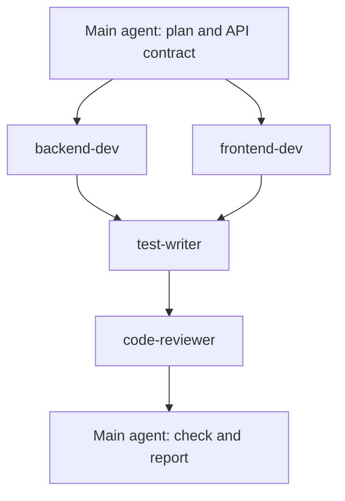

# Agent Map

An agent map is a plan that says who does what, and in which order.

## The idea

1. The main agent is the manager. It is the Claude you talk to. It makes the plan and checks the result.
2. A subagent is a specialist. It has its own fresh memory, its own tools and its own rules.
3. A subagent does one job and reports back a short summary. Its long working notes do not fill your main chat.
4. Subagents that do not depend on each other can run at the same time. This is called "in parallel".
5. The agent files live in `.claude/agents/`. Type `/agents` to see them.

## Our agents

| Agent | Owns these files | Reports back |
| --- | --- | --- |
| `backend-dev` | `backend/LearnHub.Api` only | files changed, routes, request and response shapes |
| `frontend-dev` | `frontend/` only | files changed, pages, api.js functions |
| `test-writer` | `backend/LearnHub.Tests` only | tests added, pass and fail count, bugs found |
| `code-reviewer` | nothing (reads only) | bugs, mismatches, style, missing tests |
| `ui-designer` | React pages and CSS in `frontend/` | files changed, what looks better, build result |

## Demo feature: Course discussion (Q&A per course)

Students ask questions on a course page. Anyone can answer. The trainer builds this live.

### Diagram (mermaid)



### Diagram (ASCII)

```
          +--------------------------------+
          | Main agent: plan + API contract|
          +---------------+----------------+
                          |
            +-------------+-------------+
            |   (run at the same time)  |
            v                           v
     +-------------+            +--------------+
     | backend-dev |            | frontend-dev |
     +------+------+            +-------+------+
            |                           |
            +-------------+-------------+
                          v
                  +---------------+
                  |  test-writer  |
                  +-------+-------+
                          v
                  +---------------+
                  | code-reviewer |
                  +-------+-------+
                          v
          +--------------------------------+
          | Main agent: check and report   |
          +--------------------------------+
```

### Steps

| Step | Agent | Input | Output | Runs in parallel with |
| --- | --- | --- | --- | --- |
| 1 | Main agent | Your feature request | A plan and an API contract (routes, request and response shapes) | none |
| 2a | `backend-dev` | The plan and the contract | Model, store methods, endpoints, build passes | `frontend-dev` |
| 2b | `frontend-dev` | The plan and the contract | Discussion section on the course page, api.js calls, build passes | `backend-dev` |
| 3 | `test-writer` | The new store methods from step 2a | New xUnit tests, all passing | none |
| 4 | `code-reviewer` | All changed files | A short list of problems, or "no problems" | none |
| 5 | Main agent | The four reports | Fixes for any problem, then a summary for you | none |

Why a contract? The frontend does not wait for the backend. Both build to the same routes and shapes, so they fit at the end.

## Sample prompt for the trainer

```
Add "Course discussion": on each course page, students can post a question
(studentName, text) and anyone can post an answer to a question.

First, write a short plan and an API contract (routes, request bodies, responses).
Then use backend-dev and frontend-dev IN PARALLEL, both following the contract.
When both finish, use test-writer for the new store methods.
Then use code-reviewer on all changes.
Fix any problems it finds. Finish with a summary of what each agent reported.
```
